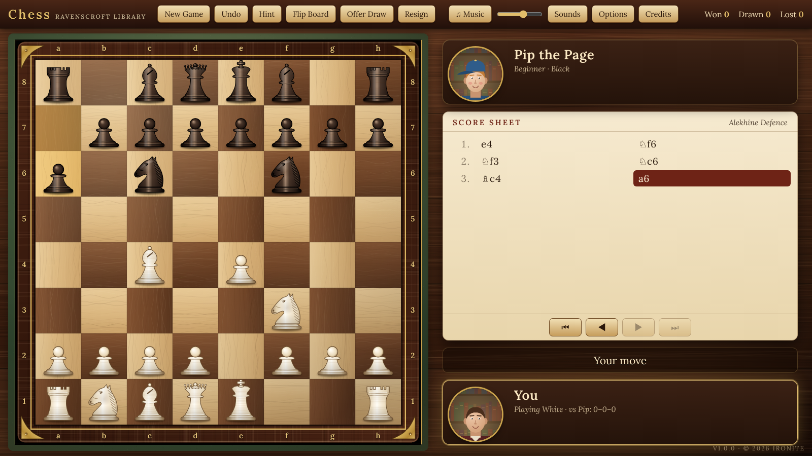

# Chess: Ravenscroft Library


An Ironite game for Windows. Play six opponents at the Ravenscroft Library, from Pip the Page (just learning the moves) to the Old Master, or a friend on the same computer.

- Full rules: castling, en passant, promotion, check, checkmate, stalemate, threefold repetition, the fifty-move rule and insufficient material
- Computer opponents in six strengths (alpha-beta search in a Web Worker, with an opening book)
- HD ivory and ebony pieces and three boards, drawn in code at the screen's full resolution up to 4K
- Optional chess clocks, hints, undo, draw offers, resign, flip board
- Score sheet in standard notation that names the opening, game review, PGN copy
- Four original chamber pieces and wooden-board sound effects
- Saves the unfinished game, your record and settings in `%APPDATA%\Ironite\Chess`



## Layout

| Path | What it is |
| --- | --- |
| `web/` | The game: rules engine (`chess.js`), AI (`ai.js`), art, music, opening book, UI |
| `app/` | Go shell that serves `web/` locally and opens it in an Edge app window; `rsrc_windows_amd64.syso` carries the icon and version info |
| `installer/` | Inno Setup script (`ChessSetup.iss`) plus the shared Ironite template and wizard art |
| `tools/` | Tests: `perft.js` (move generation), `aitest.js` / `wac.js` (tactics), `match.js` (level vs level), `musiccheck.js` |
| `art/` | Icon, launcher cover and featured banner |

## Build

```
./build.sh                        # needs Go 1.24+; writes dist/Chess/Chess.exe
ISCC.exe installer\ChessSetup.iss # Inno Setup 6.3+; writes dist/Output/Chess-Setup-v1.0.0.exe
node tools/perft.js               # rules check
```

To try the game without building, serve the repo root with any static web server and open `web/index.html`.

Every release needs a matching entry in `web/CHANGELOG.md` and `VERSION` in `web/game.js`.

## Credits

Developed and published by Ironite. All art, music and sound are original. Typeface: Lora (SIL Open Font License, see `web/fonts/OFL.txt`).

Copyright (c) 2026 Ironite. All rights reserved.
